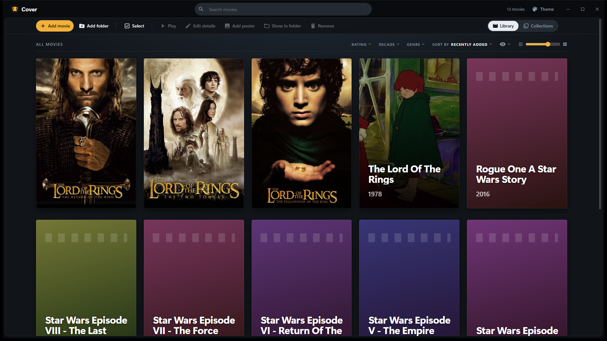

<p align="center">
  
</p>

<h1 align="center">Cover</h1>

<p align="center">
  <b>Your own movie library, as a wall of posters.</b><br>
  A light, portable Windows app that turns the movies on your drives into a shelf you can browse.<br>
  Add a folder or a single movie, and it shows up as a poster. Double-click it and it plays in your default player.
</p>

<p align="center">
  
  
  
  
</p>

---

## Features

- Poster wall with an adjustable size, up to 3 posters per row; titles and years are read from the file names
- Your own posters (drop, paste or pick an image), or a frame taken from the movie
- Collections with their own cover art, like a franchise box set; drag the posters into your own order, and each collection remembers how you sort it
- Keep the Library tidy: hide movies that are already in a collection, or hide any movie you like; they stay in their collections
- Ratings, genres, director, release year and a watched mark for every movie
- Filters by rating, decade and genre; sorting by title, release date, director, rating and more
- Several color themes, including a retro one
- Search across the whole library
- Movies play in your default player; nothing is uploaded anywhere
- Portable: one folder, no installer, no account, no internet needed

## Screenshot

<p align="center">
  
</p>

## How it works

One small program written in **Rust**. It runs a local server on `127.0.0.1` and shows the page in its own window with Microsoft Edge WebView2, which is part of Windows. The window has no Windows title bar: Cover's top bar works as the title bar, like Spotify or Discord. The page (HTML, CSS, JS, fonts) is built into the exe, and your library lives in a `data\` folder next to it.

```
Cover.exe         the app: server and window in one file
src\              main.rs (window), server.rs (JSON API), library.rs (movies, collections),
                  paths.rs, dialogs.rs, platform.rs, web.rs (built-in page)
web\              the page: HTML, CSS, JS, fonts
data\             your library, posters, collections, settings (not in this repo)
launcher\         icon of Cover.exe
brand\            logo
```

## Run it from source

You need Windows 10/11 and [Rust](https://rustup.rs).

```bash
cargo run --release
```

The library is kept next to the exe, so a run from source uses `target\release\data\`. Run `cargo test` for the tests.

## Build the portable folder

1. Build the exe:

   ```bash
   cargo build --release
   ```

2. Copy `target\release\cover.exe` to a new folder as `Cover.exe`, together with `THIRD-PARTY-NOTICES.txt`. The `data\` folder is created on first run.

## Third-party software

The fonts, the WebView2 loader and the Rust crates have their own licenses. See [THIRD-PARTY-NOTICES.txt](THIRD-PARTY-NOTICES.txt).

## License

Copyright © 2026. All rights reserved. The source is published for viewing and as a portfolio piece; it may not be copied, modified, redistributed or sold without permission.
